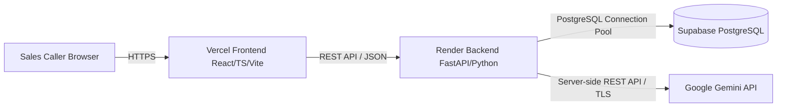
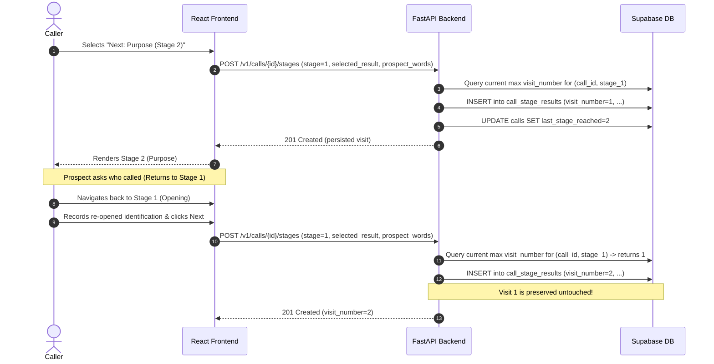
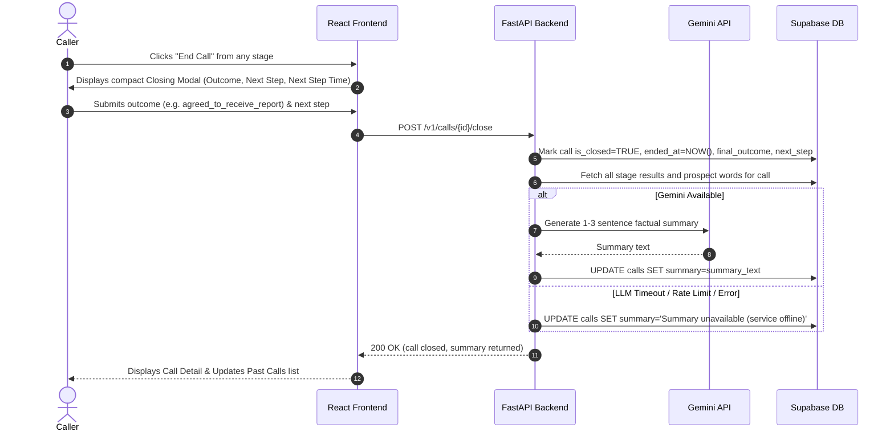

# Architecture & Design Specification — Cold Call Companion

## 1. System Overview

Cold Call Companion is a specialized live-call navigation surface for sales professionals engaged in B2B outreach to Indian enterprise leaders. It guides callers through the eight official stages of a cold call, provides transcript-informed conversational cues, logs what happened via quick-tap pills and verbatim notes, and preserves complete visit history when stages are revisited.

---

## 2. Component Architecture

### Frontend (React + TypeScript + Vite)
- **Deployment Target:** Vercel (Edge CDN distribution).
- **Core Responsibilities:**
  - Fast, glanceable call guide interface.
  - Active call timer, prospect header, and visual 8-stage progress tracker.
  - Stage purpose, three transcript-grounded likely responses, and quick-tap outcome pills.
  - Single free-text area for capturing prospect's exact words.
  - Forward/backward navigation with stage re-visit support.
  - Always-available **End Call** action leading to the 10-outcome closing panel.
  - Call history screen displaying past calls, last stage reached, outcome, and summaries.
- **Client Security:** Zero secret keys, zero direct database connections, zero direct LLM calls.

### Backend (Python + FastAPI)
- **Deployment Target:** Render (Web Service).
- **Core Responsibilities:**
  - Health check endpoint (`GET /health`).
  - RESTful API endpoints for calls and stage visits.
  - Safe backend auto-incrementation of stage `visit_number` to guarantee immutable history.
  - Strict validation of stage numbers (1–8), call lifecycle states, and 10 outcome tags.
  - Asynchronous LLM summary generation with configurable timeout (default 30s) and graceful fallback.
  - Database access layer connecting to Supabase PostgreSQL with connection pooling.

### Database (Supabase PostgreSQL)
- **Storage Layer:** Hosted PostgreSQL with UUID v4 primary keys.
- **Tables:**
  - `calls`: Call session metadata, start/end timestamps, last stage reached, final outcome, next step, and AI summary.
  - `call_stage_results`: Append-only stage visits, capturing stage number, visit number, selected tap option, and verbatim prospect words.
- **Integrity Constraints:**
  - `UNIQUE (call_id, stage_number, visit_number)`
  - Foreign key cascading deletes.
  - Check constraints on stage numbers (1–8) and final outcomes (10 official categories).

### LLM Service (Google Gemini API)
- **Model:** Gemini 2.5 / 1.5 Flash via server-side Google GenAI SDK.
- **Role:** Generates a 1–3 sentence factual post-call summary upon call closure.
- **Safety & Fallback:**
  - Never mutates prospect notes or caller-selected outcome.
  - Enforces prompt injection isolation by treating caller notes as untrusted content.
  - If rate-limited, unreachable, or timed out, the call closes successfully and sets status to `"Summary unavailable"`.

---

## 3. Data Flow & Sequence

### Stage Progression & Revisit Flow

### Call Closing & Post-Call Summary Flow

---

## 4. The 10 Call Outcomes Specification

The product preserves all ten distinct outcome categories identified in the transcript corpus:

1. `next_step_agreed`: A fixed appointment, scheduled callback, or document review meeting was agreed.
2. `agreed_to_receive_report`: Prospect consented to receive a diagnostic report or company profile (WhatsApp or Email).
3. `interested`: Prospect expressed positive verbal interest but did not establish a fixed time or deliverable.
4. `follow_up`: Prospect asked caller to call back later (e.g., in a meeting, driving, after 2 PM).
5. `call_again`: Call interrupted by poor line quality, background noise, or language barrier.
6. `not_interested`: Prospect explicitly declined the value proposition.
7. `do_not_call`: Prospect requested immediate removal from the call list, or caller determined harsh refusal.
8. `wrong_person`: Phone number reached someone other than the intended target or someone who does not handle this domain.
9. `moved_company`: Target individual is no longer employed with the organization.
10. `not_logged`: Call ended prematurely or without a designated outcome.
